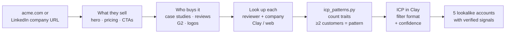

# icp-research-agent

**Give it a company URL and it works out who that company actually sells to. It reads the case studies, reviews and customer logos, looks up the people and companies behind them, counts the patterns, and returns an ICP as ready-to-paste Clay filters plus 5 real lookalike accounts, each with a verified buying signal.**

Runs as a [Claude Code](https://claude.com/claude-code) skill. The research is done by the agent. The counting is done by a Python script, because language models are bad at counting.



## Why it's built this way

**Evidence beats copy.** A company's homepage says who it *wants* to sell to. Its case studies and G2 reviewers show who actually *buys*. The skill ranks sources by strength:

1. Case studies (name, industry, size, results)
2. On-site testimonials (reviewer title + company)
3. Third-party reviews: G2, Capterra, Trustpilot, Product Hunt
4. Customer logos
5. Fallback: competitors' customers, job posts, the company's own LinkedIn

**Every claim has a count.** A trait only enters the ICP if at least 2 customers share it, and confidence is computed from the share instead of being judged by the model:

| Confidence | Rule |
|---|---|
| **H** | 3+ customers and ≥ 60% share |
| **M** | ≥ 40% share |
| **L** | shared by 2+, but under 40% |

**No invented signals.** Each of the 5 example accounts needs a buying signal the agent actually confirmed (funding, a relevant hire, a competitor in their stack). If none is found, the output says *"no live signal found"* instead of making one up.

## The counter

[`skill/scripts/icp_patterns.py`](skill/scripts/icp_patterns.py) is pure Python with no dependencies. It reads the agent's evidence table, buckets headcount into bands, classifies job titles into seniority and department, and counts.

```text
$ python skill/scripts/icp_patterns.py examples/evidence.csv
## ICP: Clay list-building format (7 customers analysed)
**Company filters**
- Industry: B2B SaaS (Confidence: H - 5 of 7 customers match "B2B SaaS")
- Company size (employees): 51-200, 201-500 (Confidence: M - 4 of 7 customers match "51-200")
- Growth stage / funding: Series A, Series B, Seed (Confidence: M - 3 of 7 customers match "Series A")
- Geography: US (Confidence: H - 5 of 7 customers match "US")
- Business model: B2B (Confidence: H - 6 of 7 customers match "B2B")
- Tech stack: HubSpot, Clay, Salesforce (Confidence: H - 5 of 7 customers match "HubSpot")

**People filters (buyer persona)**
- Seniority: Head / Director, Manager (Confidence: M - 3 of 7 customers match "Head / Director")
- Department: RevOps / Sales Ops, Marketing / Growth (Confidence: M - 3 of 7 customers match "RevOps / Sales Ops")
```

Fintech and Marketplace each appear once, so they're dropped as noise.

## Full output

The skill prints:

1. **What they sell**: main product, the problem it solves, how sure
2. **Evidence table**: every customer analysed, with source
3. **ICP in Clay format**: company filters, people filters, buying signals, who to avoid, each line with confidence + evidence
4. **5 example companies**: why each fits, and the signal that was verified

## Install

```bash
cp -r skill ~/.claude/skills/icp-search
```

Then in Claude Code:

```text
/icp-search acme.com
```

Optional: the [Clay plugin](https://github.com/clay-run/agent-plugins) for firmographic lookups and lookalike search. Without it, the skill falls back to web research and says so in the output.

## Tests

```bash
pip install pytest && pytest -q
# 5 passed
```

## Layout

```text
skill/
  SKILL.md                 the research workflow Claude follows
  scripts/icp_patterns.py  evidence CSV -> counted ICP
examples/evidence.csv      sample evidence table
tests/
```

## License

MIT
